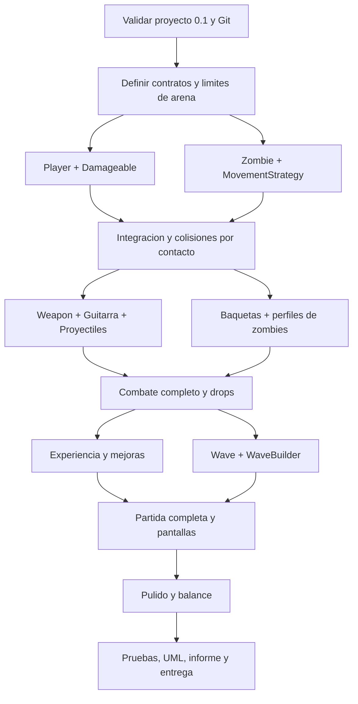
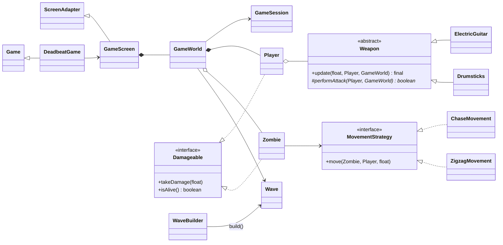

# DEADBEAT — Ruta de desarrollo detallada

> **Versión del plan:** 1.0  
> **Fecha:** 23 de octubre de 2026  
> **Estado del proyecto:** prototipo 0.1, arena y ciclo de renderizado implementados en código; ejecución en los equipos de desarrollo pendiente de verificar.  
> **Tecnologías:** Java 11, LibGDX 1.14.2, LWJGL3, Gradle Wrapper 7.6.4, Git/GitHub.  
> **Equipo propuesto:** dos programadores (P1 y P2).  
> **Base documental:** `Bases Proyectos S1-2026 (1).pdf` (apartado GM, p. 3; entregas y reporte, pp. 3-4); `Deadbeat_Prototipo_0_1.zip` y su `README.md`.

---

## 0. Propósito y modo de uso

Este documento es **la hoja de ruta de implementación**, no el informe final para evaluación. Define qué construir, en qué orden, quién lo hará, qué archivos cambiará, cómo verificar el resultado y dónde quedará la evidencia para la rúbrica. Se debe actualizar durante el desarrollo: marcar las tareas completadas, anotar decisiones y enlazar los commits/PR correspondientes.

**Convenciones:**

- `[x]` Existe en el código actual (no implica que ya se haya ejecutado en todos los computadores).
- `[ ]` Pendiente de implementar o validar.
- **P1:** responsable de jugador, armas, experiencia y mejoras.
- **P2:** responsable de zombies, oleadas, pantallas y presentación.
- **AMBOS:** diseño de contratos, integración, pruebas, UML y documentación.
- **MVP:** versión mínima jugable que cumple las funcionalidades acordadas y permite completar una partida.
- **Bloqueante:** impide avanzar a otro módulo; debe resolverse antes de desarrollar sobre él.

**Advertencia administrativa:** el documento del curso indica grupos de **tres integrantes**, con posibles excepciones de cuatro; **no especifica grupos de dos**. Antes de formalizar el equipo, solicitar autorización al profesor/ayudante. Este plan distribuye el trabajo técnicamente entre dos, pero no sustituye esa autorización.

### 0.1 Definición del videojuego

**Deadbeat** es un *survivors-like* 2D de vista superior, ambientado en una ciudad postapocalíptica de estética punk. El protagonista sobrevive a hordas de zombies usando **una guitarra eléctrica que lanza ondas/proyectiles sonoros** y **unas baquetas que golpean a enemigos cercanos**. Los ataques se ejecutan automáticamente; el jugador controla movimiento, posicionamiento y mejoras.

**Bucle jugable:** moverse → esquivar zombies → ataques automáticos → derrotar enemigos → recolectar experiencia → subir de nivel → elegir mejora → superar oleadas → victoria/derrota.

**Premisa narrativa breve:** el último músico de una ciudad destruida convierte sus instrumentos en armas y se abre paso a través de un concierto interminable de muertos vivientes.

### 0.2 Alcance aprobado para MVP

| Sistema | Decisión de alcance |
|---|---|
| Pantalla de juego | Una sola arena 2D, cámara fija, resolución lógica 960 × 540 |
| Jugador | Un personaje; WASD / flechas opcionales; movimiento diagonal normalizado |
| Armas | 2: guitarra eléctrica (proyectil automático), baquetas (golpe en área cercana) |
| Enemigos | 3 perfiles: normal, rápido, tanque; sin jefe obligatorio |
| IA | Persecución directa y movimiento alternado/zigzag para demostrar Strategy |
| Oleadas | 5 oleadas; duración inicial propuesta: 30 s cada una |
| Experiencia | Cristales/objetos que aparecen al derrotar zombies y se recolectan al acercarse |
| Mejoras | 6: daño guitarra, cadencia guitarra, daño baquetas, cadencia baquetas, velocidad de movimiento, vida máxima |
| Pantallas | Menú, partida, pausa, selección de mejora, resultado final |
| Resultado | Victoria tras completar la oleada 5 vivo; derrota con vida ≤ 0 |
| Arte/sonido | Primero figuras provisionales; luego sprites/efectos y sonidos con licencia apropiada |
| Red | Sin multijugador, partidas online ni cuentas de usuario |

**No hacer para el MVP:** inventario, tienda, generación procedural de mapas, árbol de habilidades persistente, multijugador, físicas avanzadas, armas adicionales, jefe final, logros, guardado en la nube. Estos son **extras** únicamente si todo el MVP y la rúbrica están completos.

### 0.3 Condiciones técnicas

- **JDK 11** para desarrollar y ejecutar, salvo que el docente exija específicamente JDK 8. El proyecto actual está configurado para código Java 11.
- **Gradle Wrapper 7.6.4**, ya fijado en `gradle/wrapper/gradle-wrapper.properties`. No cambiar arbitrariamente a Gradle 8.3 en medio del desarrollo.
- **LibGDX 1.14.2**, definida en `gradle.properties`.
- **Gradle** divide el código en `core` (juego, independiente del sistema operativo) y `lwjgl3` (ejecución en escritorio).
- **Eclipse o NetBeans** según el entorno permitido por el curso; el documento indica Eclipse o NetBeans 21 o inferior.
- **GitHub** con commits significativos, revisiones entre compañeros y al menos 6 commits como requisito explícito.
- **Código propio:** inspirarse en los juegos entregados, pero **no copiar código** de proyectos previos ni de terceros, según el enunciado.

---

## 1. Punto de partida real (prototipo 0.1)

### 1.1 Archivos que existen en el ZIP

```text
Deadbeat_Inicio/
├── build.gradle
├── settings.gradle
├── gradle.properties
├── gradlew
├── gradlew.bat
├── gradle/wrapper/
│   ├── gradle-wrapper.jar
│   └── gradle-wrapper.properties
├── assets/
│   └── README.txt
├── core/
│   ├── build.gradle
│   └── src/main/java/com/deadbeat/
│       ├── DeadbeatGame.java
│       ├── screens/GameScreen.java
│       └── world/GameWorld.java
├── lwjgl3/
│   ├── build.gradle
│   └── src/main/java/com/deadbeat/lwjgl3/
│       └── Lwjgl3Launcher.java
└── README.md
```

### 1.2 Inventario de lo implementado

- [x] `DeadbeatGame extends Game` abre `GameScreen` y libera la pantalla activa.
- [x] `GameScreen extends ScreenAdapter` contiene `FitViewport`, `SpriteBatch`, `BitmapFont` y llama a `world.update()` / `world.draw()`.
- [x] `GameWorld` dibuja un suelo, cuadrícula, bordes e indicador animado usando una textura de 1 × 1 creada con `Pixmap`.
- [x] `Lwjgl3Launcher` configura una ventana 960 × 540, sincronización vertical y objetivo de 60 FPS.
- [x] Se muestra un contador de tiempo y la tecla `ESC` cierra el prototipo.
- [x] Wrapper de Gradle y dependencias LibGDX/LWJGL3 declarados.
- [ ] Comprobar compilación con dependencias reales y arranque gráfico en el computador de **P1**.
- [ ] Comprobar compilación con dependencias reales y arranque gráfico en el computador de **P2**.
- [ ] Configurar GitHub remoto, permisos, ramas y convención de commits.
- [ ] Comenzar `Player`, `Zombie`, interfaces y colisiones.

> **Importante:** actualmente el prototipo **no tiene jugador, zombies ni armas**. El cuadrado que pulsa en el centro es solamente un indicador visual de `update(delta)`. Tampoco se ha verificado aquí una ejecución gráfica completa en los equipos de los desarrolladores.

### 1.3 Comandos de arranque y validación

Abrir una terminal en la raíz `Deadbeat_Inicio/`:

```powershell
# Windows / PowerShell
java -version
.\gradlew.bat --version
.\gradlew.bat :core:compileJava :lwjgl3:compileJava
.\gradlew.bat :lwjgl3:run
```

Criterios de aceptación del arranque:

- [ ] Gradle utiliza una JVM compatible, preferentemente JDK 11.
- [ ] La compilación termina sin errores.
- [ ] Se abre `DEADBEAT - Prototipo 0.1`.
- [ ] Aparece el fondo oscuro con cuadrícula, borde fucsia e indicador animado.
- [ ] El contador aumenta y no se congela.
- [ ] `ESC` cierra sin excepciones.
- [ ] Cambiar tamaño de ventana no deforma la proporción gracias a `FitViewport`.

Si falla el entorno, **corregirlo antes de comenzar a añadir funcionalidad**. Guardar error y solución en `docs/DECISIONES.md` o en una incidencia de GitHub.

---

## 2. Reglas arquitectónicas y contratos

### 2.1 Responsabilidades de cada capa

| Capa | Responsabilidad | Qué NO debe hacer |
|---|---|---|
| `DeadbeatGame` | Inicializar la aplicación, navegar entre pantallas, disponer recursos globales | Calcular daño o mover zombies |
| `screens/*` | Entrada de usuario, HUD, renderizado, transición visual y controles de pantalla | Poseer reglas internas de combate |
| `world/GameWorld` | Coordinar entidades, actualización, spawns, colisiones y estado local de partida | Crear ventanas, leer archivos de configuración del IDE |
| `entities/*` | Estado y comportamiento propio de jugador/zombie/orbes/proyectiles | Cambiar de pantalla o controlar la oleada |
| `weapons/*` | Cadencia, objetivo, generación y ejecución de ataques | Dibujar menús o finalizar la partida |
| `movement/*` | Algoritmos de desplazamiento de zombies | Conocer puntajes y pantallas |
| `progression/*` | Experiencia, mejoras y configuración de oleadas | Renderizar directamente con LibGDX |
| `managers/GameSession` | Estado único de la partida (fase, oleada, bajas y resultado) | Duplicar HP/posición que son propiedad de `Player` |

### 2.2 Reglas comunes de implementación

1. **Coordenadas** en unidades lógicas del mundo (960 × 540), independientes del tamaño real de ventana.
2. **Velocidad** en unidades por segundo: `desplazamiento = velocidad * delta`.
3. **Diagonal normalizada:** pulsar W+D no debe ser más rápido que W solamente.
4. **Delta limitado:** el proyecto actual usa `Math.min(delta, 0.05f)` para evitar saltos gigantes al reanudar la ventana.
5. **Un propietario por recurso:** toda `Texture`, `SpriteBatch`, `BitmapFont`, `Sound`, etc. debe tener un responsable claro de llamar `dispose()`.
6. **Encapsulamiento:** atributos `private`; getters según necesidad. Evitar campos públicos mutables.
7. **Colecciones:** evitar eliminar elementos de `Array`/`List` desde un `for-each` de forma insegura; recorrer desde el final cuando corresponda o marcar/remover después.
8. **Responsabilidad de entidades:** cada objeto actualiza su propio estado; `GameWorld` orquesta las interacciones entre objetos.
9. **Sin variables estáticas globales innecesarias:** `GameSession` será el Singleton exigido, pero no sustituirá la inyección de referencias cuando corresponda.
10. **Probar al integrar:** no acumular cinco ramas sin ejecutar el juego.
11. **Escala:** primero figuras y cuadrados; después efectos y sprites.
12. **Separar lógica de presentación:** poder inspeccionar y probar estadísticas sin depender de que un sprite exista.

### 2.3 Contratos iniciales mínimos

**`Player`** (P1):

```java
public void update(float delta);
public void takeDamage(float damage);
public boolean isAlive();
public float getX();
public float getY();
public float getRadius();
public float getHealth();
```

**`Damageable`** (P1 crea; ambos acuerdan):

```java
public interface Damageable {
    void takeDamage(float damage);
    boolean isAlive();
}
```

**`Zombie`** (P2):

```java
public void update(float delta, Player target);
public void takeDamage(float damage);
public boolean isAlive();
public float getX();
public float getY();
public float getRadius();
```

**`MovementStrategy`** (P2):

```java
public interface MovementStrategy {
    void move(Zombie zombie, Player target, float delta);
}
```

**`GameWorld`** (P2 mantiene estructura, ambos integran):

```java
public void update(float delta);
public void draw(SpriteBatch batch);
public Player getPlayer();
public Zombie findNearestZombie(float x, float y, float maxRange);
```

> Las firmas son **contratos propuestos**. Se consolidarán en la primera reunión técnica antes de abrir ramas. No representan métodos implementados en el ZIP 0.1.

**Contrato de integración de armas (etapa siguiente):**

- `Player` mantiene el equipamiento (`List<Weapon>` o equivalente) y sus estadísticas.
- `Weapon` ejecuta su ataque mediante `update(delta, player, world)`.
- `GameWorld` registra proyectiles y consulta colisiones; las armas no modifican directamente listas internas de zombies mientras se iteran.
- `Zombie` recibe daño a través de `Damageable`; al morir informa a `GameWorld`, que decide el drop de experiencia.

### 2.4 Área útil y colisiones

El dibujo actual tiene bordes decorativos dentro de la resolución 960 × 540. Se propone una **región jugable aproximada** `x ∈ [24, 936]`, `y ∈ [68, 452]` para centros de entidades, ajustada por su radio. Esta región debe declararse como constantes compartidas o como un `Rectangle` propiedad de `GameWorld`; **no** duplicar números mágicos en `Player` y `Zombie`.

Modelo MVP de colisión: entidades representadas por círculos con centro `(x, y)` y radio `r`:

```text
dx = ax - bx
dy = ay - by
colisionan si dx*dx + dy*dy <= (ra + rb)^2
```

No usar raíces cuadradas para cada comparación si basta la distancia al cuadrado.

### 2.5 Árbol objetivo de paquetes

```text
core/src/main/java/com/deadbeat/
├── DeadbeatGame.java
├── screens/
│   ├── GameScreen.java                 # Existe
│   ├── MenuScreen.java                 # Etapa 3
│   ├── PauseScreen.java                # Etapa 3
│   ├── UpgradeScreen.java              # Etapa 3
│   └── ResultScreen.java               # Etapa 3
├── world/
│   └── GameWorld.java                  # Existe; se amplía
├── entities/
│   ├── Damageable.java                 # Etapa 1
│   ├── Player.java                     # Etapa 1
│   ├── Zombie.java                     # Etapa 1
│   ├── ZombieType.java                 # Etapa 2
│   ├── Projectile.java                 # Etapa 2
│   └── ExperienceOrb.java              # Etapa 3
├── movement/
│   ├── MovementStrategy.java           # Etapa 1
│   ├── ChaseMovement.java              # Etapa 1
│   └── ZigzagMovement.java             # Etapa 2
├── weapons/
│   ├── Weapon.java                     # Etapa 2
│   ├── ElectricGuitar.java             # Etapa 2
│   └── Drumsticks.java                 # Etapa 2
├── progression/
│   ├── Wave.java                       # Etapa 3
│   ├── WaveBuilder.java                # Etapa 3
│   ├── Upgrade.java                    # Etapa 3
│   └── UpgradeManager.java             # Etapa 3; opcional si simplificable
└── managers/
    └── GameSession.java                # Etapa 3

lwjgl3/src/main/java/com/deadbeat/lwjgl3/
└── Lwjgl3Launcher.java                 # Existe

assets/
├── sprites/
├── audio/
└── fonts/

docs/
├── RUTA_DESARROLLO.md
├── DECISIONES.md
├── UML.md
├── PRUEBAS.md
└── INFORME_GM.md
```

El archivo `GameWorld` ya existe: no crear otra clase que compita por administrar la partida. `UpgradeManager` se añadirá solo si simplifica realmente la lógica; la rúbrica no exige una cantidad determinada de clases.

---

## 3. Dependencias y orden obligatorio de desarrollo



**Ruta crítica:** que `GameWorld` compile con `Player` y `Zombie` → que el combate funcione → que las oleadas y pantallas puedan completar una partida. Si cualquiera de esas uniones falla, detener funciones nuevas y corregir la integración.

---

## 4. Calendario propuesto — cuatro semanas

> **Este calendario es una propuesta de organización**, no una fecha del docente ni un compromiso de duración. Reordenar según la fecha real de entrega; nunca sacrificar las pruebas ni el reporte por añadir extras.

| Semana | Meta verificable | P1 — énfasis | P2 — énfasis | Cierre conjunto |
|---|---|---|---|---|
| **1** | Arena + jugador + 5 zombies + daño por contacto | Controles, `Player`, `Damageable`, viewport | `Zombie`, persecución, spawn, estado del mundo | Prototipo 0.2 integrado y ejecutable |
| **2** | Dos armas, tres enemigos y combate completo | `Weapon`, guitarra, baquetas, proyectiles | Perfiles de zombies, Strategy adicional, colisiones y drops | Prototipo 0.3: se puede combatir y morir |
| **3** | Experiencia, mejoras, cinco oleadas, menú/pausa/resultado | XP, nivel, seis mejoras, selección | `WaveBuilder`, gestión de oleadas, pantallas y HUD | Prototipo 0.4: se puede ganar o perder |
| **4** | Calidad, arte, pruebas, patrones e informe | Efectos de combate, balance, evidencia de armas/Strategy | Audio, sprites, UI, evidencia de Builder y Template | Versión 1.0 + documentación + paquete de entrega |

### 4.1 Rutina recomendada de coordinación

- **Inicio de semana (ambos):** revisar metas, confirmar firmas públicas y asignar tareas en GitHub Issues.
- **Trabajo independiente:** cada programador trabaja en su rama, hace commits pequeños y verifica compilación.
- **Integración a mitad de semana:** merge de una funcionalidad completa por vez, ejecución conjunta y registro de errores.
- **Cierre semanal:** demostración jugable, revisión de requisitos GM y actualización de este archivo.
- **Ante bloqueos:** registrar incidente con descripción, error, pasos de reproducción, responsable y decisión tomada.

---

## 5. Semana 1 — Núcleo del juego (versión 0.2)

### Objetivo

Abrir el juego, mover al protagonista en ocho direcciones, hacer aparecer cinco zombies, perseguir al jugador y aplicar daño por contacto con un tiempo breve de invulnerabilidad.

### 5.1 Preparación de entorno y acuerdos — AMBOS

**ID: DB-001 a DB-006**

- [ ] **DB-001:** importar el proyecto Gradle 0.1 en ambos computadores y compilarlo.
- [ ] **DB-002:** ejecutar el prototipo 0.1, comprobar pantalla/redimensionamiento y registrar resultado.
- [ ] **DB-003:** crear repositorio GitHub privado o público según las indicaciones del curso; subir el código propio.
- [ ] **DB-004:** acordar nombres de métodos, coordenadas, radios, tipos `float`, constantes y quién dispone recursos.
- [ ] **DB-005:** crear paquetes `entities` y `movement`; documentar las decisiones en `docs/DECISIONES.md`.
- [ ] **DB-006:** crear un Issue por módulo y dividir responsabilidades entre P1/P2.

**Entregable:** proyecto compila en ambos equipos y hay una rama principal limpia.

### 5.2 Jugador — P1

**ID: DB-101 a DB-107**

- [ ] **DB-101:** crear `Damageable` con `takeDamage(float)` e `isAlive()`.
- [ ] **DB-102:** crear `Player implements Damageable` con `x`, `y`, `radius`, `speed`, `health`, `maxHealth` (atributos privados).
- [ ] **DB-103:** lectura de W/A/S/D usando `Gdx.input.isKeyPressed` desde `Player` o un adaptador de entrada simple.
- [ ] **DB-104:** calcular un vector `(dx, dy)` y normalizar si su longitud es mayor que cero.
- [ ] **DB-105:** aplicar movimiento por `speed * delta` y limitar al rectángulo jugable.
- [ ] **DB-106:** implementar daño, invulnerabilidad temporal (valor de partida propuesto: **0,65 s**) y muerte al llegar a cero.
- [ ] **DB-107:** dibujar un personaje provisional (cuadrado o sprite) desde `GameWorld`, sin crear texturas nuevas cada fotograma.

**Valores iniciales para pruebas (ajustables):** vida 100, velocidad 185 unidades/s, radio 14 unidades.

**Criterios de aceptación P1:**

1. WASD permite moverse en ocho direcciones.
2. W+D no produce ventaja de velocidad respecto de W.
3. El protagonista no atraviesa paredes ni la zona de HUD.
4. Dejar de pulsar teclas detiene el movimiento.
5. La vida no baja por debajo de cero; `isAlive()` refleja el estado real.
6. Recibir varios contactos seguidos durante la invulnerabilidad no descuenta vida múltiples veces.

### 5.3 Zombies y persecución — P2

**ID: DB-201 a DB-207**

- [ ] **DB-201:** crear `Zombie implements Damageable` con posición, radio, velocidad, vida y daño de contacto.
- [ ] **DB-202:** crear interfaz `MovementStrategy`.
- [ ] **DB-203:** crear `ChaseMovement` que calcula vector del zombie hacia el jugador, lo normaliza y avanza según `delta`.
- [ ] **DB-204:** asignar estrategia mediante constructor o setter validado (`null` no permitido).
- [ ] **DB-205:** añadir colección `List<Zombie>` o `Array<Zombie>` a `GameWorld`.
- [ ] **DB-206:** generar cinco zombies desde posiciones válidas y separadas del jugador (provisionalmente fijas para pruebas).
- [ ] **DB-207:** actualizar/dibujar zombies desde `GameWorld` y retirar zombies muertos.

**Valores iniciales para pruebas:** vida 30, velocidad 75 unidades/s, radio 13 y daño por contacto 10.

**Criterios de aceptación P2:**

1. Los cinco zombies aparecen en pantalla al iniciar.
2. Se desplazan hacia la posición actual del jugador, no hacia el punto donde apareció inicialmente.
3. El movimiento no depende visiblemente de los FPS.
4. No generan errores al coincidir con la posición exacta del jugador (vector de longitud cero).
5. Ningún zombie cambia directamente de pantalla o lee entrada de teclado.

### 5.4 Integración y choque — AMBOS

**ID: DB-301 a DB-305**

- [ ] **DB-301:** conectar `Player` y `Zombie` al `GameWorld` existente sin duplicar mundos.
- [ ] **DB-302:** añadir detección circular de colisiones jugador-zombie.
- [ ] **DB-303:** aplicar daño al jugador respetando la invulnerabilidad.
- [ ] **DB-304:** mostrar vida provisional en texto; señal visual al recibir daño.
- [ ] **DB-305:** revisar `dispose()` y compilación después del merge.

**Prueba de cierre 0.2:** iniciar → moverse → atraer cinco zombies → recibir daño → observar reducción de HP → terminar la partida de prueba al morir (aunque aún no exista pantalla de derrota definitiva).

**No pasar a Semana 2** si los zombies siguen fallando al perseguir, si el personaje cruza los límites, o si el merge no compila.

---

## 6. Semana 2 — Combate y enemigos (versión 0.3)

### Objetivo

Hacer jugable el combate automático con guitarra y baquetas. Implementar tres perfiles de zombie y demostrar la existencia de **clase abstracta + dos subclases**, **interfaz con dos implementadores**, **Strategy** y **Template Method** en código realmente utilizado.

### 6.1 Clase abstracta `Weapon` — P1

**ID: DB-401 a DB-404**

- [ ] **DB-401:** crear `abstract class Weapon` con daño, intervalo de ataque y tiempo restante de enfriamiento.
- [ ] **DB-402:** crear método **`final update(delta, player, world)`** que actualice cooldown y, cuando corresponda, invoque un método gancho.
- [ ] **DB-403:** crear `protected abstract boolean performAttack(Player, GameWorld)`; el valor indica si hubo ataque válido.
- [ ] **DB-404:** crear subclases `ElectricGuitar` y `Drumsticks` que sobreescriben `performAttack(...)`.

**Contrato Template Method:** `Weapon.update()` define el algoritmo invariable: disminuir temporizador → verificar si puede atacar → ejecutar parte variable → reiniciar cooldown si hubo ataque. **Las subclases no deben reemplazar `update()`**. La abstracción se debe instanciar indirectamente en el juego mediante sus dos hijas.

### 6.2 Guitarra eléctrica — P1

**ID: DB-411 a DB-416**

- [ ] **DB-411:** buscar el zombie vivo más cercano dentro de un alcance máximo desde `GameWorld`.
- [ ] **DB-412:** crear `Projectile` con posición, velocidad, dirección, daño, radio y vida útil.
- [ ] **DB-413:** al atacar, la guitarra genera un proyectil orientado hacia el objetivo seleccionado.
- [ ] **DB-414:** mover proyectiles por `delta`.
- [ ] **DB-415:** detectar impacto proyectil-zombie, aplicar daño **una vez por proyectil**, retirarlo en impacto o al expirar.
- [ ] **DB-416:** dibujar proyectil provisional de color fucsia/cian y ajustar cadencia.

**Valores iniciales propuestos:** daño 22; intervalo 0,85 s; alcance de selección 300 unidades; velocidad del proyectil 400 unidades/s. Ajustar en pruebas de balance.

**Aceptación:** sin pulsar teclas de ataque, la guitarra dispara a un zombie dentro de rango; no dispara a objetivos inexistentes, muertos o fuera de alcance; los proyectiles no quedan almacenados indefinidamente.

### 6.3 Baquetas de batería — P1

**ID: DB-421 a DB-424**

- [ ] **DB-421:** implementar `Drumsticks extends Weapon`.
- [ ] **DB-422:** cada ataque golpea a zombies a distancia circular limitada alrededor del jugador.
- [ ] **DB-423:** aplicar daño **una vez a cada zombie alcanzado por cada golpe**, no una vez por frame.
- [ ] **DB-424:** mostrar un pulso circular breve como señal visual del impacto.

**Valores iniciales propuestos:** daño 12; intervalo 0,55 s; alcance 65 unidades.

**Aceptación:** la baqueta golpea enemigos cercanos, no alcanza enemigos alejados y comparte la lógica de cadencia de la clase abstracta.

### 6.4 Variedad de zombies y Strategy — P2

**ID: DB-431 a DB-437**

- [ ] **DB-431:** crear `enum ZombieType { NORMAL, FAST, TANK }`.
- [ ] **DB-432:** implementar valores diferenciados sin crear tres subclases innecesarias si solo cambian estadísticas.
- [ ] **DB-433:** `NORMAL`: persecución directa.
- [ ] **DB-434:** `FAST`: más velocidad, menos vida; implementar y probar `ZigzagMovement`.
- [ ] **DB-435:** `TANK`: más vida, menor velocidad, mayor daño de contacto.
- [ ] **DB-436:** asignar y cambiar `MovementStrategy` en ejecución; por ejemplo, FAST alterna persecución y zigzag según distancia/ciclo.
- [ ] **DB-437:** representar los tres tipos con tamaños/colores provisionales distinguibles.

**Estadísticas iniciales propuestas (sujetas a balance):**

| Tipo | Vida | Velocidad | Daño contacto | Movimiento inicial |
|---|---:|---:|---:|---|
| Normal | 30 | 75 | 10 | `ChaseMovement` |
| Rápido | 18 | 120 | 7 | `ZigzagMovement` / alternable |
| Tanque | 90 | 45 | 16 | `ChaseMovement` |

**Aceptación de Strategy:** `Zombie` mantiene una **referencia a la interfaz**, no `if` anidados que reimplementen los algoritmos; se observan comportamientos diferentes y se demuestra un cambio real de estrategia.

### 6.5 Integración de daño, muertes y drops — AMBOS

**ID: DB-441 a DB-446**

- [ ] **DB-441:** insertar ambas armas en la colección de equipamiento del jugador.
- [ ] **DB-442:** actualizar armas solamente durante estado `PLAYING`.
- [ ] **DB-443:** centralizar `GameWorld` para administrar proyectiles, colisiones y remoción de entidades.
- [ ] **DB-444:** al morir un zombie, incrementar un contador de bajas (temporalmente en mundo, luego en `GameSession`).
- [ ] **DB-445:** comprobar que un zombie muerto no cause daño ni reciba múltiples drops.
- [ ] **DB-446:** preparar un punto único `onZombieKilled(zombie)` que la semana 3 generará `ExperienceOrb`.

**Prueba de cierre 0.3:** entrar a la arena → moverse → la guitarra dispara → las baquetas golpean al acercarse → los zombies mueren → aparecen perfiles diferentes → el jugador puede morir. Ejecutar durante varios minutos para buscar crecimiento incontrolado de objetos.

---

## 7. Semana 3 — Partida completa (versión 0.4)

### Objetivo

Convertir el combate en un juego con progresión y final: experiencia, subida de nivel, elección de mejoras, cinco oleadas, menú/pausa y victoria/derrota.

### 7.1 Experiencia y niveles — P1

**ID: DB-501 a DB-506**

- [ ] **DB-501:** crear `ExperienceOrb` con ubicación, radio y cantidad de XP.
- [ ] **DB-502:** cada zombie eliminado puede generar un orbe (MVP: uno garantizado para facilidad de prueba).
- [ ] **DB-503:** detectar recolección mediante proximidad jugador-orbe.
- [ ] **DB-504:** agregar `experience`, `level`, `experienceToNextLevel` al estado correspondiente (`Player` o componente dedicado, **sin duplicarlo**).
- [ ] **DB-505:** al llegar al umbral, subir nivel y conservar experiencia sobrante.
- [ ] **DB-506:** detener la simulación al mostrar opciones de mejora.

**Modelo simple propuesto:** el umbral de XP se calcula de forma determinista, por ejemplo `8 + 4 * (nivel - 1)`. Elegir y fijar una fórmula, anotarla en el informe y ajustarla tras probar una partida completa.

### 7.2 Mejoras — P1

**ID: DB-511 a DB-518**

- [ ] **DB-511:** definir `Upgrade` con identificador, nombre, descripción y operación de aplicación (interfaz/enum/componente simple, sin duplicar sistemas).
- [ ] **DB-512:** implementar **6 mejoras funcionales** (tabla inferior).
- [ ] **DB-513:** sortear hasta 3 **opciones diferentes**, excluyendo mejoras que alcanzaron su límite.
- [ ] **DB-514:** aplicar exclusivamente la mejora elegida.
- [ ] **DB-515:** actualizar HUD y estadísticas reales tras aplicar la mejora.
- [ ] **DB-516:** fijar límites razonables para evitar valores imposibles (cooldown negativo, vida máxima cero, etc.).
- [ ] **DB-517:** tratar subidas múltiples: si se acumulan dos niveles, resolver elecciones sucesivas sin perderlas.
- [ ] **DB-518:** probar cada mejora por separado y combinaciones.

| ID mejora | Efecto propuesto | Validación |
|---|---|---|
| `GUITAR_DAMAGE` | +20 % daño de guitarra | Siguiente proyectil aplica más daño |
| `GUITAR_RATE` | -10 % al intervalo de disparo (con mínimo) | Se observan más disparos por período |
| `DRUM_DAMAGE` | +20 % daño de baquetas | Baja más HP por golpe |
| `DRUM_RATE` | -10 % al intervalo de golpe (con mínimo) | Aumenta frecuencia de pulsos |
| `MOVE_SPEED` | +10 % velocidad del jugador (con máximo) | Avanza más distancia con mismo `delta` |
| `MAX_HEALTH` | +20 HP máximos y cura 20, sin sobrepasar el nuevo máximo | HUD y vida actual coherentes |

> Los porcentajes y topes son **decisiones propuestas de balance**, no requisitos del curso. Definirlos en constantes o configuración centralizada, no diseminarlos en `GameScreen`.

### 7.3 Oleadas y Builder — P2

**ID: DB-521 a DB-527**

- [ ] **DB-521:** crear clase `Wave` con configuración de duración y cantidades de cada tipo de zombie.
- [ ] **DB-522:** crear `WaveBuilder` con métodos encadenables y `build()`.
- [ ] **DB-523:** validar con `build()` que duración sea positiva y cantidades no negativas; devolver una configuración válida.
- [ ] **DB-524:** construir cinco configuraciones con Builder, no con listas hardcodeadas dentro del render.
- [ ] **DB-525:** desarrollar el generador que distribuye apariciones durante la duración de cada oleada.
- [ ] **DB-526:** aumentar dificultad entre oleadas según configuración.
- [ ] **DB-527:** finalizar la partida con victoria cuando concluya la quinta oleada y el jugador siga vivo.

**Propuesta de configuración para balance inicial:**

| Oleada | Duración | Normales totales | Rápidos totales | Tanques totales |
|---|---:|---:|---:|---:|
| 1 | 30 s | 14 | 0 | 0 |
| 2 | 30 s | 16 | 4 | 0 |
| 3 | 30 s | 20 | 6 | 1 |
| 4 | 30 s | 24 | 10 | 3 |
| 5 | 30 s | 28 | 14 | 5 |

**Decisión de partida que se debe fijar antes de implementar:** ¿una oleada termina por **tiempo** o por **eliminación de todos sus enemigos**? Para el MVP proponemos **tiempo**, con transición automática y eliminación/control explícito de enemigos restantes según una regla documentada. Una regla simple: los zombies supervivientes permanecen durante la siguiente oleada, con un **tope global de zombies vivos** para evitar saturación. Al terminar el último tiempo, se evalúa victoria si el jugador está vivo. Mantener el HUD consistente con esta decisión.

**Aceptación de Builder:** las cinco oleadas se crean invocando `WaveBuilder`; `Wave` no requiere setters dispersos; `build()` detecta parámetros inválidos; variar una configuración no obliga a modificar `GameWorld`.

### 7.4 Singleton y estados — AMBOS (P2 integra pantallas)

**ID: DB-531 a DB-535**

- [ ] **DB-531:** crear `GameSession` con constructor privado e instancia única; inicialización segura adecuada a una aplicación de escritorio.
- [ ] **DB-532:** almacenar oleada, bajas, estado de partida y resultado, **no duplicar la vida y posición del jugador**.
- [ ] **DB-533:** implementar `reset()` antes de iniciar una nueva partida.
- [ ] **DB-534:** definir estados claramente, por ejemplo `MENU`, `PLAYING`, `PAUSED`, `CHOOSING_UPGRADE`, `VICTORY`, `DEFEAT`.
- [ ] **DB-535:** verificar que cambiar de pantalla respeta el estado de sesión y no deja simulaciones actualizándose detrás.

**Nota:** Singleton debe tener una justificación concreta en el informe; no se utiliza solo porque la rúbrica lo pide. Su utilidad será compartir el estado de la sesión entre pantallas sin crear múltiples instancias incoherentes.

### 7.5 Menú, pausa, selección, HUD y resultado — P2

**ID: DB-541 a DB-549**

- [ ] **DB-541:** crear `MenuScreen` con opciones **Jugar** y **Salir**.
- [ ] **DB-542:** modificar `DeadbeatGame` para iniciar con el menú.
- [ ] **DB-543:** cambiar la función de `ESC`: desde el juego debe abrir/reanudar pausa; el cierre directo del prototipo 0.1 deja de aplicar.
- [ ] **DB-544:** crear pausa con **Continuar**, **Reiniciar** y **Menú** (puede ser pantalla dedicada u overlay claro).
- [ ] **DB-545:** pantalla de elección de una de tres mejoras, que detiene tiempo, enemigos y proyectiles.
- [ ] **DB-546:** HUD de HP, nivel/XP, oleada, tiempo restante y bajas.
- [ ] **DB-547:** pantalla de **victoria** con estadísticas y reinicio.
- [ ] **DB-548:** pantalla de **derrota** con estadísticas y reinicio.
- [ ] **DB-549:** asegurar que reiniciar libera el mundo anterior, reinicia `GameSession` y no duplica texturas o listeners.

**Aceptación de pantallas:** se puede entrar desde menú, pausar/reanudar, elegir mejora, perder, ganar, reiniciar y volver al menú. Mientras el juego está pausado o esperando mejora, no avanza la simulación.

### 7.6 Integración de semana 3 — AMBOS

- [ ] Completar una partida de cinco oleadas sin errores.
- [ ] Recoger experiencia y demostrar que se modifican estadísticas tras elegir una mejora.
- [ ] Verificar que `reset()` devuelve oleada, bajas, XP y HP a sus valores iniciales.
- [ ] Comprobar que morir durante cualquier oleada produce derrota y no victoria.
- [ ] Comprobar que llegar vivo al final de oleada 5 produce victoria.
- [ ] Registrar evidencia (capturas o video breve) para GM-1 y GM-2.

---

## 8. Semana 4 — Arte, pruebas, documentación y entrega (versión 1.0)

### 8.1 Identidad visual punk — P2, con revisión de P1

- [ ] Fondo de ciudad abandonada con asfalto, grietas, graffitis y elementos visuales que no obstaculicen la lectura.
- [ ] Protagonista punk distinguible del grupo de zombies.
- [ ] Guitarra claramente reconocible; onda/proyectil sonoro visualmente diferenciable.
- [ ] Baquetas representadas con golpe circular/pulso.
- [ ] Tres siluetas/colores reconocibles para zombie normal, rápido y tanque.
- [ ] Indicaciones visuales de daño, invulnerabilidad, caída de XP y mejora elegida.
- [ ] Tipografía y colores legibles; contraste suficiente en HUD.
- [ ] Ajustar recursos a la pantalla sin estiramiento incorrecto.
- [ ] Añadir sonidos de disparo/golpe/zombie/selección con volumen configurable si el tiempo alcanza.
- [ ] Documentar autoría/licencia de cualquier recurso externo y evitar utilizar material protegido sin permiso.

**Propuesta estética:** negro carbón, morado, verde ácido y fucsia; sprites pixel art o 2D simplificados, sin necesidad de animaciones complejas.

### 8.2 Rendimiento y estabilidad — P1 (ambos prueban)

- [ ] Probar con 1, 20, 50 y 80 zombies activos.
- [ ] No crear `Texture`, `Pixmap` ni `BitmapFont` dentro de `render()`.
- [ ] Destruir o reciclar proyectiles al chocar, salir de zona o vencer su tiempo de vida.
- [ ] Remover zombies muertos y orbes recogidos de sus colecciones.
- [ ] Establecer un límite configurable de enemigos vivos para proteger rendimiento.
- [ ] Revisar los picos de `delta`, especialmente al minimizar y maximizar.
- [ ] Revisar pausas y reinicios repetidos para evitar recursos duplicados.
- [ ] Comprobar que no hay excepciones al morir el último zombie durante el mismo frame en que impacta un proyectil.
- [ ] Mantener al menos un rendimiento fluido razonable en ambos equipos; anotar FPS observados en pruebas en lugar de asumir que serán 60.

### 8.3 Balance — AMBOS

- [ ] Completar al menos tres partidas de prueba por integrante.
- [ ] Comprobar que la guitarra y las baquetas contribuyen de verdad al combate.
- [ ] La primera oleada debe permitir aprender los controles; la quinta debe ser más exigente.
- [ ] Ninguna mejora debe romper el juego al acumularse.
- [ ] Revisar tiempo de supervivencia, muertes, XP obtenida y mejoras elegidas.
- [ ] Registrar cambios de daño/velocidad/oleadas y motivo de cada ajuste.

### 8.4 Documentación y entrega — AMBOS

- [ ] Crear diagrama UML final con clases propias y relevantes de LibGDX.
- [ ] Documentar explícitamente abstracta, interfaz, Singleton, Strategy, Template Method y Builder.
- [ ] Preparar GM-1: narrativa, objetivo, controles, personajes, elementos y capturas/maquetas.
- [ ] Preparar GM-2: juego base elegido, qué se tomó como **referencia conceptual** y qué modificaciones se desarrollaron.
- [ ] Preparar evidencia de cada requisito: archivo, clase, método, captura y/o línea de código.
- [ ] Incluir instrucciones de instalación y ejecución reproducibles.
- [ ] Incluir código fuente completo y archivos necesarios para ejecutar.
- [ ] Confirmar que existen al menos 6 commits significativos en GitHub (preferentemente varios de cada integrante).
- [ ] Realizar una prueba de ejecución limpia desde un clon del repositorio o la carpeta final exportada.
- [ ] Preparar coevaluación firmada según indicaciones del curso.
- [ ] Verificar que el equipo de dos haya sido autorizado (si aplica).
- [ ] Revisar fechas y modo de entrega en el aula virtual; **este plan no inventa una fecha límite**.

**Nota de la rúbrica:** el reporte escrito responde requisito por requisito y puede representar hasta el 20 % del puntaje asociado a cada ítem; omitir explicaciones reduce la calificación posible aunque el código exista. La guía también contempla coevaluación con ponderación del 45 % de la nota del proyecto. Para presentación, si se programa, el formato indicado es pitch de 5 minutos.

---

## 9. Patrones de diseño: especificación y evidencia obligatoria

### GM-4 — Clase abstracta e interfaz

**Clase abstracta:** `Weapon` con subclases reales `ElectricGuitar` y `Drumsticks`. Se deben instanciar **ambas** en el juego y ejecutar sus ataques a través del tipo base.

**Interfaz:** `Damageable` implementada y utilizada por `Player` y `Zombie`. El código de colisiones o daño debe operar, al menos en alguna parte, sobre la interfaz y no solo realizar conversiones de tipo innecesarias.

**Evidencia:** UML de herencia/implementación y referencias a `Weapon.java`, `ElectricGuitar.java`, `Drumsticks.java`, `Damageable.java`, `Player.java`, `Zombie.java`.

### GM-6 — Singleton

**Problema:** múltiples pantallas podrían crear estados divergentes de oleada, bajas y resultado.  
**Contexto:** aplicación monojugador y una sola sesión activa.  
**Solución:** `GameSession` con instancia única y `reset()`, compartida por los componentes que necesitan estado de sesión.  
**Evidencia mínima:** constructor privado, mecanismo único de acceso, prueba de unicidad, prueba de reinicio, UML específico.

### GM-7 — Strategy

**Problema:** los zombies pueden necesitar distintas formas de moverse sin mezclar algoritmos en una clase gigante.  
**Contexto:** zombie normal o tanque persiguen directamente; zombie rápido puede zigzaguear/cambiar estrategia.  
**Solución:** interfaz `MovementStrategy`; concretas `ChaseMovement`, `ZigzagMovement`; `Zombie` delega su desplazamiento a una estrategia intercambiable.  
**Evidencia mínima:** dos clases concretas implementadas, asignación y cambio de estrategia durante partida, UML y captura/video de comportamiento distinto.

### GM-8 — Template Method

**Problema:** dos armas comparten el ciclo de cadencia pero ejecutan ataques completamente diferentes.  
**Contexto:** guitarra dispara proyectiles; baquetas realizan ataque cercano.  
**Solución:** `Weapon.update()` es método plantilla `final` que controla enfriamiento y llama a `performAttack()` sobreescrito.  
**Evidencia mínima:** código de método plantilla, método abstracto y ambas sobreescrituras, diagrama UML y prueba con las dos armas equipadas.

### GM-9 — Builder

**Problema:** crear cinco oleadas con diversos parámetros se vuelve propenso a errores si se utilizan constructores enormes o setters sin validación.  
**Contexto:** se requiere variar cantidades de tipos de zombies y duración por oleada.  
**Solución:** `WaveBuilder` con interfaz fluida y `build()` validado; objeto `Wave` de configuración estable.  
**Evidencia mínima:** construcción real de cinco oleadas por Builder, validaciones al construir, UML específico y prueba de configuración inválida.

### Diagrama conceptual de clases (a revisar durante la implementación)



Este UML es **un diseño objetivo**, no refleja todavía clases existentes: debe actualizarse con firmas y relaciones reales antes de la entrega.

---

## 10. Matriz de trazabilidad de rúbrica GM-1 a GM-10

| Requisito (enunciado) | Cómo lo cubre Deadbeat | Evidencia a preparar | Responsable principal | Estado |
|---|---|---|---|---|
| **GM-1** Explicación desde perspectiva del jugador | Objetivo, narrativa, controles, armas, zombies, XP, HUD, maquetas/capturas | Sección del reporte + 4-6 capturas etiquetadas | P2 + revisión P1 | [ ] |
| **GM-2** Análisis de ingeniería; base y modificaciones | `SpaceNav2024` como referencia principal para movimiento/proyectiles/colisiones; `GameLluviaMenu2024` para pantallas/objetos; sistema propio de supervivencia | Comparativa base vs. Deadbeat, arquitectura y lista de modificaciones | AMBOS | [ ] |
| **GM-3** UML del dominio con LibGDX + código Java | Diagrama de `Game`, `ScreenAdapter`, entidades, armas, estrategias, oleadas | UML final + nombres de paquetes/clases | AMBOS | [ ] |
| **GM-4** Abstracta con ≥2 hijas e interfaz con ≥2 implementaciones | `Weapon` → guitarra/baquetas; `Damageable` → jugador/zombie | UML + código + ejecución real | P1 | [ ] |
| **GM-5** Encapsulamiento y POO | Atributos privados, responsabilidades, herencia, composición y polimorfismo | Revisión de clases y muestras de código | AMBOS | [ ] |
| **GM-6** Singleton | `GameSession` | Problema/contexto/solución, UML y código | AMBOS | [ ] |
| **GM-7** Strategy | Estrategias de movimiento, incluidas dos concretas | Problema/contexto/solución, UML, cambio real de estrategia | P2 | [ ] |
| **GM-8** Template Method | Ciclo de ataque `Weapon.update()` y acciones concretas | Problema/contexto/solución, UML y ambas armas | P1 | [ ] |
| **GM-9** Builder | `WaveBuilder` crea configuraciones `Wave` | Problema/contexto/solución, UML, cinco usos reales | P2 | [ ] |
| **GM-10** GitHub: ≥6 commits | Repositorio, commits de desarrollo e integraciones | URL de repositorio, historial y contribuciones | AMBOS | [ ] |

**Importante:** la rúbrica pide **diseño y explicación** además de código en varios puntos. Un patrón implementado sin justificar problema, contexto, solución y UML queda incompleto para GM-6 a GM-9.

---

## 11. Plan de pruebas detallado

Registrar resultados en `docs/PRUEBAS.md` indicando **ID**, versión/commit, sistema operativo, responsable, resultado esperado, resultado observado y si pasó/falló.

| ID | Escenario | Resultado esperado | Etapa |
|---|---|---|---|
| T-001 | Abrir la aplicación | Se inicia la pantalla sin errores | 0 |
| T-002 | Redimensionar ventana | Se conserva relación visual de 960 × 540 | 0 |
| T-003 | Mover W, A, S, D | Desplazamiento en dirección correcta | 1 |
| T-004 | Mover W+D simultáneamente | Velocidad total igual a la de movimiento axial | 1 |
| T-005 | Caminar hacia el borde | Jugador no abandona la arena | 1 |
| T-006 | Dejar teclado en reposo | Jugador queda quieto | 1 |
| T-007 | Zombie persigue al jugador móvil | Recalcula dirección y lo sigue | 1 |
| T-008 | Zombie coincide exactamente con jugador | Sin NaN, división por cero ni bloqueo | 1 |
| T-009 | Zombie toca al jugador | Recibe daño una vez y activa invulnerabilidad | 1 |
| T-010 | Contacto prolongado | La vida baja con el intervalo previsto, no 60 veces/s | 1 |
| T-011 | Guitarra sin enemigo en alcance | No dispara; no falla | 2 |
| T-012 | Guitarra con enemigo cercano | Proyectil dirigido al objetivo válido | 2 |
| T-013 | Proyectil impacta | Zombie recibe daño una vez | 2 |
| T-014 | Proyectil caduca/sale | Se elimina, sin acumulación infinita | 2 |
| T-015 | Baquetas con zombie cercano | Zombie recibe daño de área | 2 |
| T-016 | Baquetas sin zombie cercano | No daña enemigos alejados | 2 |
| T-017 | Zombie llega a 0 HP | Se retira y cuenta una baja | 2 |
| T-018 | Zombie cambia Strategy | Movimiento cambia sin reemplazar clase Zombie | 2 |
| T-019 | Muere enemigo y cae XP | Aparece un único orbe válido | 3 |
| T-020 | Jugador recoge XP | Aumenta experiencia y desaparece orbe | 3 |
| T-021 | XP alcanza umbral | Sube nivel y abre mejora | 3 |
| T-022 | Seleccionar mejora | Solo cambia estadística elegida y cierra pausa de selección | 3 |
| T-023 | Elegir mejora al límite | No rompe cadencia ni excede topes | 3 |
| T-024 | Oleada 1 vence por tiempo | Inicia oleada 2 según regla acordada | 3 |
| T-025 | Oleada 5 termina con jugador vivo | Victoria | 3 |
| T-026 | HP llega a 0 en oleada 3 | Derrota, sin victoria simultánea | 3 |
| T-027 | Pausar 5 segundos | Mundo, enemigos, ataques y tiempo no avanzan | 3 |
| T-028 | Reiniciar tras derrota | HP, XP, oleada, kills y entidades se reinician | 3 |
| T-029 | Reiniciar varias veces | Sin duplicación de pantallas, sprites ni eventos | 3/4 |
| T-030 | 50-80 zombies en escena | Rendimiento aceptable y sin errores de colecciones | 4 |
| T-031 | Cerrar aplicación | Sin errores de liberación de recursos | 4 |
| T-032 | Clonar en nuevo directorio y ejecutar | Dependencias resuelven y proyecto inicia | 4 |
| T-033 | Crear `Wave` inválida | Builder rechaza configuración incorrecta | 3/4 |
| T-034 | Obtener dos veces `GameSession` | Se recibe la misma instancia | 3/4 |
| T-035 | Ejecutar guitarra y baquetas | Se verifica el Template Method de la misma clase abstracta | 2/4 |

### 11.1 Pruebas automáticas recomendadas (no obligatorias por rúbrica)

Si da tiempo, añadir pruebas unitarias a `core` para la lógica sin gráficos:

- Cálculo de distancia/colisión.
- Reducción de HP, invulnerabilidad y `isAlive()`.
- Normalización de dirección y límite de arena con entrada simulada.
- `WaveBuilder` rechazando cantidades negativas y duración cero.
- Fórmula y acumulación de experiencia.
- Aplicación de mejoras y sus límites.
- Identidad única de `GameSession` y reinicio.

Para testear sin iniciar LWJGL, separar cálculos puros en métodos/clases sin acceso a `Gdx.graphics`, textura o `SpriteBatch`.

---

## 12. Git y colaboración de dos personas

### 12.1 Repositorio

Repositorio sugerido: `deadbeat` (nombre a convenir). Ramas de trabajo:

```text
main
├── feature/player-movement          # P1
├── feature/weapons-combat           # P1
├── feature/xp-upgrades              # P1
├── feature/zombies-ai              # P2
├── feature/waves-builder           # P2
└── feature/menus-hud               # P2
```

No mantener **una sola rama enorme por persona durante cuatro semanas**; abrir ramas pequeñas para funcionalidades concretas e integrarlas pronto.

### 12.2 Flujo de trabajo por funcionalidad

1. Crear Issue con ID, objetivo, archivos previstos y criterios de aceptación.
2. Crear rama desde `main` actualizado.
3. Trabajar en cambios pequeños y hacer commits descriptivos.
4. Ejecutar compilación antes de publicar.
5. Crear Pull Request que explique qué cambió y cómo probarlo.
6. El otro programador revisa firmas, recursos, encapsulamiento y colisiones.
7. Integrar en `main` solo si compila y la funcionalidad se probó.
8. Actualizar tareas y evidencia en este documento y/o GitHub Projects.

### 12.3 Ejemplos de commits útiles

```text
chore: inicializar repositorio Deadbeat y documentar entorno
feat(player): agregar movimiento WASD normalizado
feat(zombies): implementar persecucion con MovementStrategy
feat(combat): agregar guitarra y proyectiles de sonido
feat(combat): integrar ataque circular de baquetas
feat(waves): construir oleadas con WaveBuilder
feat(ui): agregar pantallas de menu y pausa
fix(combat): evitar daño repetido durante invulnerabilidad
refactor(core): separar renderizado de logica de mundo
docs: agregar UML y evidencia de patrones GM
```

**Mínimo de la rúbrica:** 6 commits; **recomendación práctica:** una secuencia de commits distribuidos entre ambos que evidencie trabajo real. No fabricar commits vacíos solo para llegar al mínimo.

### 12.4 Archivos con mayor riesgo de conflicto

- `GameWorld.java`: P2 administra estructura; P1 solicita métodos necesarios y los integran juntos.
- `GameScreen.java`: P1 durante prototipo, P2 para UI; acordar un momento de transferencia de responsabilidad.
- `DeadbeatGame.java`: modificar en conjunto cuando aparezcan nuevas pantallas.
- `gradle.properties`, `build.gradle`: cambiar solamente con coordinación para mantener entorno reproducible.
- `docs/UML.md` y `docs/INFORME_GM.md`: ambos editan por secciones e integran mediante PR.

---

## 13. Reparto de trabajo y carga estimada

Se busca un reparto **aproximadamente equilibrado en esfuerzo**, no idéntico en cantidad de clases. Una clase de combate puede requerir mucho más tiempo que varias clases de configuración.

| Área | P1 | P2 | Coordinación |
|---|---|---|---|
| Entorno e infraestructura | Revisión | Revisión | Ambos |
| Movimiento y salud jugador | **Principal** | Revisión | Contratos |
| Zombies y movimiento | Revisión | **Principal** | Integración |
| Combate e instrumentos | **Principal** | Revisión y pruebas | Colisiones |
| Experiencia y mejoras | **Principal** | Pantalla de elección | API de mejora |
| Oleadas y Builder | Pruebas | **Principal** | Spawn en mundo |
| Menús, HUD y resultados | Apoyo | **Principal** | Estados compartidos |
| Singleton y sesión | Implementación/revisión conjunta | Implementación/revisión conjunta | Ambos |
| Arte y sonido | Efectos de armas | Entorno, sprites, UI | Licencias |
| UML, pruebas e informe | Armas/Strategy/GM-4 | IA/Builder/pantallas | Ambos |

### Regla de coevaluación interna

Cada integrante mantiene un registro simple en `docs/CONTRIBUCIONES.md`:

```markdown
| Fecha | Integrante | Issue | Entrega realizada | Commit/PR | Probado por |
|---|---|---|---|---|---|
```

Esto facilita la coevaluación y evita discusiones al final. El curso solicita un acta de coevaluación firmada, con la ponderación descrita en su guía.

---

## 14. Riesgos, decisiones y planes de contingencia

| Riesgo | Señal de advertencia | Prevención / respuesta |
|---|---|---|
| Diferentes JDK/Gradle | Compila en un PC y falla en otro | Usar Wrapper 7.6.4 y JDK 11; documentar salida de `--version` |
| Conflictos de merge | Ambos editan `GameWorld` sin acuerdo | Definir API, revisar PR y fusionar pequeñas unidades |
| Patrones artificiales | Existen clases pero nunca se usan | Exigir prueba de ejecución real de cada patrón |
| Scope creep | Se añaden jefes/tiendas antes de acabar oleadas | Congelar MVP; extras solo luego de versión 1.0 funcional |
| Demasiados zombies | FPS caen o se congela el juego | Tope global, limpieza de objetos, colisiones simples |
| Daño por frame | El jugador muere instantáneamente | Temporizador de invulnerabilidad y pruebas T-009/T-010 |
| Sprites inaccesibles | Arte/sonido no cargan en el otro PC | Assets en `assets/`, rutas relativas, clonación limpia |
| Pantallas consumen memoria | Al reiniciar se duplican recursos | Ciclo de vida/dispose claro, pruebas de reinicio |
| Mejoras no afectan combate | HUD muestra cambios pero daño real no | Estadísticas únicas y pruebas numéricas de cada mejora |
| Falta evidencia en informe | Código existe pero no se puede demostrar | Matriz GM y captura por requisito desde el inicio |
| Equipo de dos no permitido | Restricción administrativa del curso | Pedir autorización temprana; adaptar reparto si no procede |
| Falta tiempo | Hay mecánicas incompletas cerca de entrega | Congelar extras; priorizar jugabilidad, patrones, estabilidad, informe |

### Plan de recorte si la fecha de entrega se acerca

**Nunca recortar:** funcionamiento del juego, clase abstracta + dos hijas, interfaz + dos implementaciones, Singleton, Strategy, Template Method, Builder, UML, encapsulamiento, GitHub, reporte, instalación/ejecución.

**Recortar primero:** animaciones complejas, efectos de partículas, transiciones elaboradas, sonidos adicionales, mejoras extra, escenarios alternativos, jefe final y personalización estética excesiva.

**Revisar con docente si el tiempo es crítico:** cantidad de oleadas, duración exacta o complejidad de menús. Estos detalles son decisiones de diseño, no ítems GM explícitos.

---

## 15. Definición de terminado (Definition of Done)

Una tarea **NO** se marca como completada solo porque se escribió código. Debe cumplir:

- [ ] Compila usando el Wrapper acordado.
- [ ] Tiene comportamiento observable o prueba ejecutable.
- [ ] Cumple su criterio de aceptación e identifica casos límite.
- [ ] No rompe funcionalidades ya integradas.
- [ ] Respeta encapsulamiento, contratos y gestión de recursos.
- [ ] Incluye commit y, si corresponde, PR revisado por la otra persona.
- [ ] Se actualizó la evidencia relevante (documentación, captura o prueba).

**Definición de MVP terminado:** un usuario puede abrir menú, comenzar partida, moverse, combatir zombies con ambas armas, obtener XP, escoger mejoras, atravesar cinco oleadas, pausar/reanudar y ver un resultado correcto; todas las clases y patrones exigidos están realmente implementados, probados y documentados.

**Definición de entrega terminada:** además del MVP, existen código fuente completo, archivos adicionales, instrucciones de ejecución, reporte requisito por requisito, UML, GitHub con commits y coevaluación según indicaciones del aula virtual.

---

## 16. Primeras diez acciones concretas (empezar aquí)

> No comenzar con sprites definitivos ni con un menú nuevo. Primero asegurar una base funcional con entidades que puedan convivir.

1. [ ] **AMBOS:** ejecutar el ZIP actual sin modificar y dejar constancia del resultado.
2. [ ] **AMBOS:** crear el repositorio y agregar este Markdown como `docs/RUTA_DESARROLLO.md`.
3. [ ] **AMBOS:** acordar y congelar durante Semana 1 las firmas de `Player`, `Zombie`, `Damageable`, `MovementStrategy`.
4. [ ] **P1:** crear `entities/Damageable.java`.
5. [ ] **P1:** crear `entities/Player.java` con datos privados y WASD.
6. [ ] **P2:** crear `movement/MovementStrategy.java` y `movement/ChaseMovement.java`.
7. [ ] **P2:** crear `entities/Zombie.java` con posición, vida y Strategy.
8. [ ] **AMBOS:** conectar `Player` y cinco `Zombie` a `GameWorld.update()` y `draw()`.
9. [ ] **AMBOS:** integrar colisiones por contacto e invulnerabilidad; ejecutar pruebas T-003 a T-010.
10. [ ] **AMBOS:** cerrar versión `v0.2`, registrar demo/captura, actualizar checklist y recién entonces pasar a las armas.

**Resultado esperado de esta primera iteración:** sobre una arena oscura con borde fucsia, un personaje provisional responde a WASD y cinco zombies lo persiguen. El jugador puede recibir daño, moverse, esquivar y finalmente morir. Ese será el primer hito verdaderamente jugable de **Deadbeat**.

---

## 17. Registro de avances y decisiones (mantener actualizado)

| Fecha | Hito/decisión | Responsable | Commit/Issue | Estado |
|---|---|---|---|---|
| 2026-10-23 | Identificada arquitectura del prototipo 0.1 y requisitos GM | Ambos | Pendiente | Inspección de archivos realizada |
| — | Validación del arranque en P1 y P2 | Ambos | — | Pendiente |
| — | Prototipo 0.2: jugador + zombies | Ambos | — | Pendiente |
| — | Prototipo 0.3: combate | Ambos | — | Pendiente |
| — | Prototipo 0.4: partida completa | Ambos | — | Pendiente |
| — | Versión 1.0: entrega | Ambos | — | Pendiente |

### Decisiones abiertas a cerrar temprano

- [ ] ¿El profesor autoriza oficialmente trabajar en pareja?
- [ ] ¿Ambos desarrolladores usarán el mismo IDE o IDEs distintos con Gradle?
- [ ] ¿El movimiento aceptará únicamente WASD o también flechas?
- [ ] ¿Se utilizará pausa como overlay o pantalla independiente?
- [ ] ¿Los zombies que sobrevivan al cambio de oleada permanecen? **Propuesta:** sí, con límite global.
- [ ] ¿Los recursos visuales serán pixel art original, de bibliotecas con licencia o una combinación documentada?
- [ ] ¿Dónde se guardará la evidencia del UML y de las pruebas?

---

## 18. Fuentes y distinción entre requisitos y propuestas

**Requisitos explícitos del documento del curso:** Java con JDK/IDE indicado, uso de LibGDX para videojuego, código propio, explicación de juego y modificaciones respecto del juego base, UML, clase abstracta con dos hijas, interfaz con dos implementaciones, encapsulamiento, patrones Singleton/Strategy/Template Method/Builder, GitHub con al menos seis commits, reporte y archivos de entrega, coevaluación; ver `Bases Proyectos S1-2026 (1).pdf`, especialmente pp. 1 y 3-4.

**Estado verificado por inspección del ZIP del proyecto:** módulos `core`/`lwjgl3`, clases de arranque y pantalla, dibujado simple de arena, dependencias y wrapper descritos en las secciones 1 y 2. No se deduce de esa inspección que el prototipo se haya ejecutado ya en los equipos del grupo.

**Propuestas de este plan, no exigencias del profesor:** cuatro semanas, responsabilidades de P1/P2, cantidad de oleadas, tipos/estadísticas de zombies, mejoras, cifras de balance, nombres de archivos propios, Strategy para movimiento, Template Method en armas, Singleton para sesión y Builder para oleadas. Pueden ajustarse si se documenta la decisión y se siguen cumpliendo todos los GM.

**Juegos de referencia conceptual:** `SpaceNav2024` y `GameLluviaMenu2024`, además de ideas de recolección de `GameLluvia2024`. Las modificaciones implementadas para Deadbeat deben identificarse específicamente en GM-2 y escribirse desde cero; los ejemplos no autorizan reutilizar código previo.
