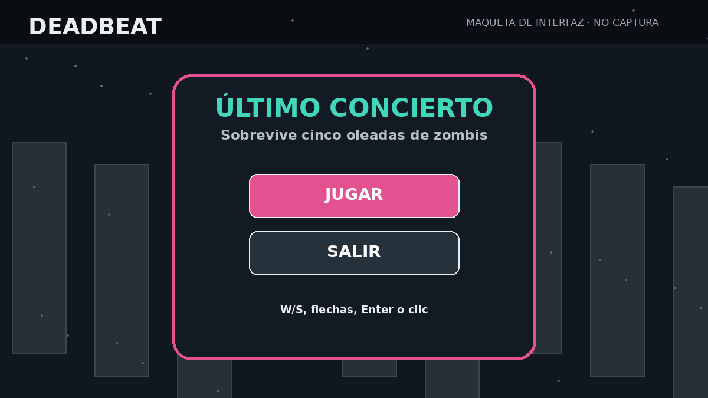
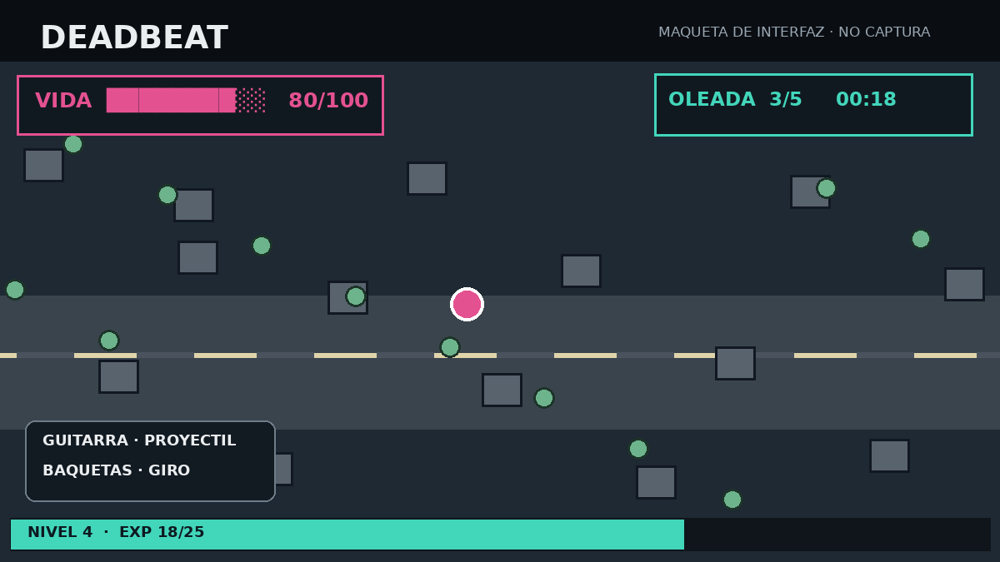
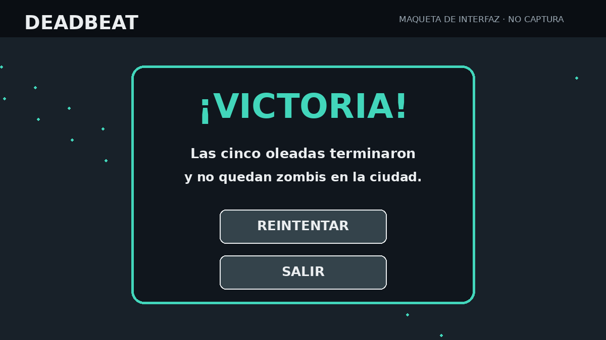
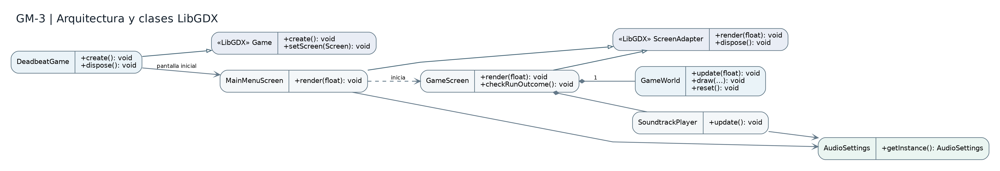
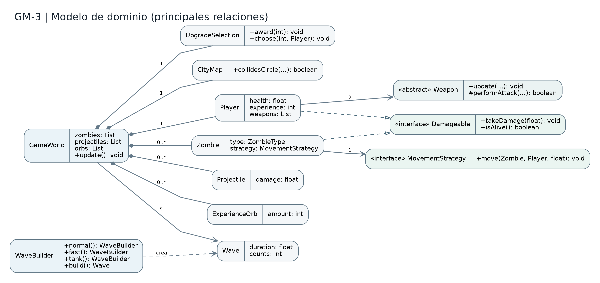
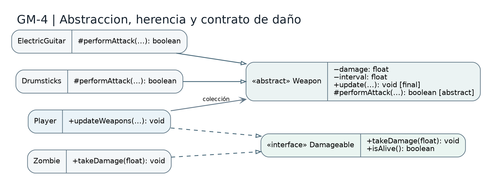
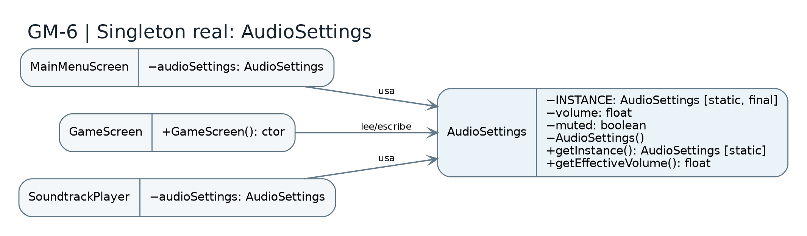
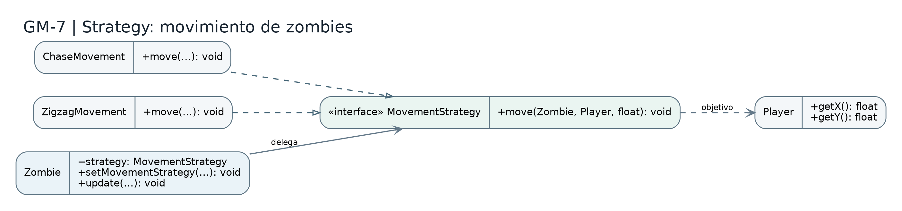
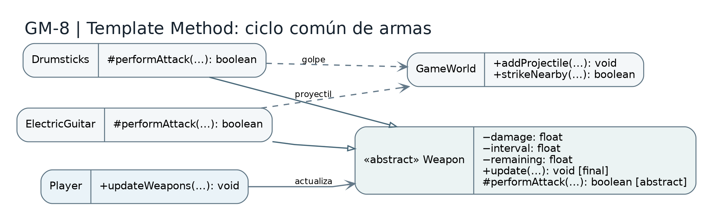
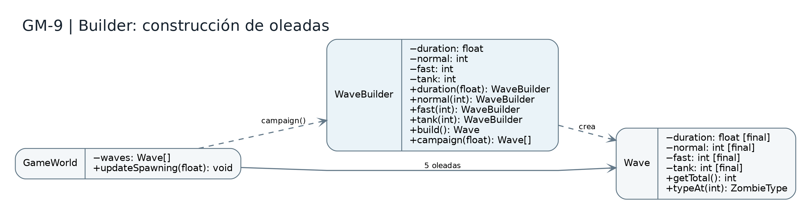

# REPORTE EJECUTIVO — DEADBEAT
**Proyecto Videojuego (GM) · Programación Avanzada**  
**Integrantes:** Sebastián Arriagada · Joaquín Carrillo · Benjamín Beltrán  
**Versión del código analizada:** [`a2f7d4b`](https://github.com/Klonoh/Deadbeat/commit/a2f7d4b1fddcd0d48232e6750be37c6d63d85b02)  
**Alcance:** rama `main`, juego implementado en Java 11 con LibGDX y LWJGL3.

## Resumen ejecutivo
Deadbeat es un juego de supervivencia 2D con cinco oleadas, armas musicales, progresión por experiencia y dos distribuciones: una edición académica compilable con JDK 11 y otra portable para Windows empaquetada con JDK 17. El presente informe responde a GM-1 a GM-10, relacionando cada requerimiento con métodos, clases y diagramas de la versión identificada. Se incluyen maquetas ilustrativas y fuentes UML editables.
Los workflows del commit de referencia finalizaron correctamente: [Académico JDK 11](https://github.com/Klonoh/Deadbeat/actions/runs/43540090728) y [Portable Windows](https://github.com/Klonoh/Deadbeat/actions/runs/43540090732). Estas validaciones automáticas no equivalen a certificar Oracle JDK 11 ni a probar manualmente la interfaz gráfica en otra computadora.

### Matriz de trazabilidad
| Requisito | Evidencia principal | Figura |
|---|---|---|
| **GM-1** | Menú, HUD, progresión, victoria/derrota | GM1_Maqueta_Menu, GM1_Maqueta_Partida, GM1_Maqueta_Victoria |
| **GM-2** | Separación de responsabilidades y módulos | GM3_Arquitectura |
| **GM-3** | LibGDX, clases propias y relaciones | GM3_Arquitectura, GM3_Dominio |
| **GM-4** | Weapon + Damageable | GM4_Abstraccion_Interfaz |
| **GM-5** | Encapsulamiento y composición | GM4_Abstraccion_Interfaz |
| **GM-6** | AudioSettings Singleton | GM6_Singleton |
| **GM-7** | MovementStrategy | GM7_Strategy |
| **GM-8** | Weapon.update() final | GM8_Template_Method |
| **GM-9** | WaveBuilder | GM9_Builder |
| **GM-10** | Commits y workflows | Historial GitHub |

## GM-1 — Experiencia del jugador

Deadbeat es un videojuego de supervivencia con vista superior ambientado en una ciudad postapocalíptica de estética punk. El jugador controla a un músico que combate hordas de zombis mediante instrumentos: una guitarra eléctrica que dispara proyectiles y unas baquetas que realizan ataques cercanos. El objetivo es sobrevivir a cinco oleadas, derrotar a todos los enemigos restantes de la quinta y evitar que la vida del protagonista llegue a cero.

El jugador puede desplazarse con WASD o flechas; los ataques de las armas se activan automáticamente. Durante la partida aparecen orbes de experiencia que permiten subir de nivel y elegir mejoras con las teclas 1, 2 y 3 o con el ratón. ESC abre o cierra la pausa; R reinicia la partida; Q y E cambian la pista musical. La tecla H inflige daño al protagonista y se conserva como control de depuración, no como mecánica principal. El menú inicial permite comenzar o salir y las pantallas finales ofrecen reintentar o abandonar.

Las oleadas emplean una duración base de 30 segundos y una cantidad predefinida de enemigos por fase. El final de la quinta oleada no produce una victoria automática si aún quedan zombis vivos. Las figuras GM1 son maquetas explicativas, no capturas tomadas de la ejecución. La rúbrica admite expresamente maquetas o pantallazos.

**Evidencia en el código (rutas bajo `DeadBeat/core/src/main/java/com/deadbeat/`, salvo indicación):**

- `screens/MainMenuScreen.java`, líneas **92–179**: render(), activate() y controles de menú.
- `screens/GameScreen.java`, líneas **158–332, 535–612**: render(), drawExperienceBar(), handleUpgradeInput(), checkRunOutcome(), drawResultScreen().
- `world/GameWorld.java`, líneas **194–251**: updateSpawning(), advanceWave(), isChoosingUpgrade().
- `entities/Player.java`, líneas **53–95, 121–209**: update(), addExperience(), updateWeapons().

*Figura: GM1 Maqueta Menu. Maqueta ilustrativa, no captura de ejecución.*

*Figura: GM1 Maqueta Partida. Maqueta ilustrativa, no captura de ejecución.*

*Figura: GM1 Maqueta Victoria. Maqueta ilustrativa, no captura de ejecución.*

## GM-2 — Análisis desde ingeniería de software

Como referencias conceptuales de organización de juegos Java se identificaron SpaceNav2024 y GameLluviaMenu2024 en el reporte inicial del equipo. Estas referencias se usan para comparar ideas de movimiento, proyectiles y organización de pantallas; el producto desarrollado es Deadbeat, con su propio dominio y mecánicas. No se atribuye código reutilizado a los ejemplos de referencia.

Las principales decisiones de diseño fueron: separación entre core (lógica del juego) y lwjgl3 (lanzador de escritorio); pantallas para menú y partida; mapa urbano con colisiones; entidades independientes; arma abstracta y dos implementaciones; estrategias de movimiento intercambiables; cinco oleadas configuradas con Builder; recompensas de experiencia y selección de mejoras; y controles de audio compartidos mediante Singleton.

GameScreen traduce entradas y presenta el estado; GameWorld coordina la simulación, aparición y eliminación de enemigos, experiencia, colisiones y oleadas; Player y Zombie concentran estado de sus entidades. Esta partición permite modificar la presentación sin reescribir la lógica de combate. Las pruebas en core verifican comportamientos independientes de la ventana gráfica, y los workflows permiten detectar regresiones en Java 11 y en el empaquetado portable.

**Evidencia en el código (rutas bajo `DeadBeat/core/src/main/java/com/deadbeat/`, salvo indicación):**

- `build.gradle` (desde `DeadBeat/`), líneas **1–24**: estructura de compilación y plugin de integración Eclipse.
- `settings.gradle` (desde `DeadBeat/`), líneas **1–2**: declaración de los módulos core y lwjgl3.
- `screens/GameScreen.java`, líneas **158–220**: orquestación de pantalla y HUD.
- `world/GameWorld.java`, líneas **99–251**: simulación, colisiones y oleadas.
- `movement/MovementStrategy.java`, líneas **1–10**: extensión del movimiento por interfaz.

*Figura: GM3 Arquitectura. Diagrama elaborado a partir de las clases del commit de referencia.*

**Comparación con las referencias conceptuales**

| Aspecto | Referencias conceptuales mencionadas en el reporte anterior | Implementación en Deadbeat |
|---|---|---|
| Entradas / movimiento | Ejemplos de movimiento y entidades | Player con control por ejes, colisión y cámara centrada |
| Proyectiles | Mecánica de proyectiles como referencia | ElectricGuitar y Projectile, ataque automático |
| Pantallas | Organización de menú y vista de juego | DeadbeatGame, MainMenuScreen, GameScreen |
| Progresión | No se infiere implementación en las referencias | Experiencia, mejoras, 5 oleadas y pantallas finales |

## GM-3 — Diagrama UML del dominio y clases LibGDX

DeadbeatGame extiende la clase Game de LibGDX y dirige la pantalla inicial a MainMenuScreen. MainMenuScreen y GameScreen extienden ScreenAdapter. GameScreen compone un GameWorld y un SoundtrackPlayer. GameWorld coordina las entidades Player, Zombie, Projectile y ExperienceOrb, las oleadas Wave, el mapa CityMap y la selección de mejoras UpgradeSelection.

En el dominio se distinguen dos contratos principales: Damageable, aplicado por Player y Zombie; y MovementStrategy, que permite a Zombie delegar en ChaseMovement o ZigzagMovement. La abstracción Weapon agrupa el comportamiento de ElectricGuitar y Drumsticks. Las configuraciones Wave se construyen con WaveBuilder. Los diagramas muestran relaciones esenciales del código actual; las fuentes editables se incluyen en uml_fuentes/.

**Evidencia en el código (rutas bajo `DeadBeat/core/src/main/java/com/deadbeat/`, salvo indicación):**

- `DeadbeatGame.java`, líneas **1–20**: extends Game, create() y setScreen().
- `screens/GameScreen.java`, líneas **23–155**: extends ScreenAdapter y composición de GameWorld.
- `entities/Player.java`, líneas **23–51**: implements Damageable; List<Weapon>.
- `entities/Zombie.java`, líneas **11–56**: implements Damageable; MovementStrategy.
- `world/GameWorld.java`, líneas **28–96**: composición de entidades y waves.

*Figura: GM3 Arquitectura. Diagrama elaborado a partir de las clases del commit de referencia.*

*Figura: GM3 Dominio. Diagrama elaborado a partir de las clases del commit de referencia.*

## GM-4 — Clase abstracta e interfaz con dos implementaciones

La clase abstracta Weapon es la generalización de dos clases utilizadas durante una partida: ElectricGuitar y Drumsticks. Player crea ambas armas al reiniciar, conserva referencias del tipo base Weapon y ejecuta su actualización polimórfica. Weapon define un método abstracto performAttack() y un método update() compartido.

La interfaz Damageable declara takeDamage(float) e isAlive(). Player y Zombie la implementan, y GameWorld utiliza ese contrato en el método damage(Damageable, float). Ambos requisitos se observan en el juego y no se limitan a clases declaradas sin uso.

**Evidencia en el código (rutas bajo `DeadBeat/core/src/main/java/com/deadbeat/`, salvo indicación):**

- `weapons/Weapon.java`, líneas **7–24**: clase abstracta y performAttack() abstracto.
- `weapons/ElectricGuitar.java`, líneas **6–20**: primera subclase concreta.
- `weapons/Drumsticks.java`, líneas **6–14**: segunda subclase concreta.
- `entities/Damageable.java`, líneas **4–10**: interfaz Damageable.
- `entities/Player.java`, líneas **23–49, 239–257**: implements Damageable, List<Weapon>, reset().
- `entities/Zombie.java`, líneas **11–20**: implements Damageable.
- `world/GameWorld.java`, líneas **293–297**: damage(Damageable, float).

*Figura: GM4 Abstraccion Interfaz. Diagrama elaborado a partir de las clases del commit de referencia.*

## GM-5 — Encapsulamiento y principios de OO

El estado mutable de las entidades se almacena en atributos privados. Player encapsula coordenadas, salud, nivel, experiencia y armas. Los métodos getWeapons() y los getters de GameWorld proporcionan vistas no modificables de sus listas, de modo que las demás clases no alteran directamente la composición interna del mundo.

La solución utiliza encapsulamiento, herencia y polimorfismo (Weapon y sus dos subclases), contratos mediante interfaces (Damageable y MovementStrategy) y composición (GameWorld con sus entidades). Las responsabilidades de presentación y simulación permanecen diferenciadas: GameScreen gestiona controles y HUD, mientras GameWorld mantiene las reglas de combate y oleadas.

**Evidencia en el código (rutas bajo `DeadBeat/core/src/main/java/com/deadbeat/`, salvo indicación):**

- `entities/Player.java`, líneas **27–51, 84–95**: atributos privados, getWeapons() y control de estado.
- `entities/Zombie.java`, líneas **11–50, 126–130**: atributos privados y estrategia encapsulada.
- `world/GameWorld.java`, líneas **52–55, 216–218, 341–343**: listas privadas y getters de sólo lectura.
- `weapons/Weapon.java`, líneas **7–24**: abstracción y actualización compartida.

*Figura: GM4 Abstraccion Interfaz. Diagrama elaborado a partir de las clases del commit de referencia.*

## GM-6 — Singleton — AudioSettings

Problema: el menú principal, la partida y el reproductor de música necesitan aplicar una sola configuración de volumen y silencio. Si cada pantalla almacenara su propio volumen, se producirían cambios inconsistentes al entrar y salir de una partida.

Contexto: Deadbeat dispone de un menú con ajustes de volumen y una pantalla de partida que reproduce pistas. La configuración debe mantenerse cuando se crea una pantalla o se vuelve al menú.

Solución: AudioSettings es una clase final con constructor privado, una instancia estática final (INSTANCE) y un único punto de acceso público getInstance(). Conserva volume y muted, valida el intervalo de volumen y ofrece getEffectiveVolume(). MainMenuScreen, GameScreen y SoundtrackPlayer acceden a la misma instancia. Este es el Singleton implementado en el código; GameSession, mencionada como propuesta en el informe anterior, no forma parte de esta versión.

**Evidencia en el código (rutas bajo `DeadBeat/core/src/main/java/com/deadbeat/`, salvo indicación):**

- `audio/AudioSettings.java`, líneas **4–39**: INSTANCE, constructor privado, getInstance(), volumen y mute.
- `screens/MainMenuScreen.java`, líneas **55, 233–279**: instancia AudioSettings y controles de sonido.
- `screens/GameScreen.java`, líneas **112–154**: lectura de configuración al iniciar partida.
- `audio/SoundtrackPlayer.java`, líneas **43, 198–219**: instancia compartida y aplicación de volumen.

*Figura: GM6 Singleton. Diagrama elaborado a partir de las clases del commit de referencia.*

## GM-7 — Strategy — desplazamiento de zombis

Problema: distintos tipos de zombis necesitan algoritmos de movimiento diferentes. Concentrarlos en Zombie con múltiples condicionales dificultaría evolucionar el comportamiento.

Contexto: los enemigos normales y tanque persiguen directamente al protagonista; el enemigo rápido utiliza además zigzag y puede alternar la estrategia durante la simulación.

Solución: MovementStrategy define move(Zombie, Player, float); ChaseMovement y ZigzagMovement concretan las variantes. Zombie almacena una referencia MovementStrategy y delega las decisiones de desplazamiento. El método setMovementStrategy() permite sustituir la estrategia sin crear otra entidad.

**Evidencia en el código (rutas bajo `DeadBeat/core/src/main/java/com/deadbeat/`, salvo indicación):**

- `movement/MovementStrategy.java`, líneas **4–8**: interfaz move().
- `movement/ChaseMovement.java`, líneas **5–9**: estrategia de persecución.
- `movement/ZigzagMovement.java`, líneas **5–11**: estrategia zigzag.
- `entities/Zombie.java`, líneas **11–74, 126–130**: selección, alternancia y delegación.

*Figura: GM7 Strategy. Diagrama elaborado a partir de las clases del commit de referencia.*

## GM-8 — Template Method — ciclo de armas

Problema: ambos instrumentos deben respetar un intervalo de ataque y descartar actualizaciones inválidas, pero generan ataques diferentes. Duplicar esa secuencia incrementaría la probabilidad de inconsistencias.

Contexto: Player mantiene una colección de Weapon y llama updateWeapons() en cada avance de simulación.

Solución: Weapon implementa update() como método final. La secuencia común valida el delta y la vida, descuenta el tiempo restante e invoca el método abstracto performAttack(). Si el ataque fue efectivo, reinicia el intervalo. ElectricGuitar implementa la creación de un proyectil y Drumsticks ejecuta un ataque cercano. Las subclases redefinen sólo el paso variable.

**Evidencia en el código (rutas bajo `DeadBeat/core/src/main/java/com/deadbeat/`, salvo indicación):**

- `weapons/Weapon.java`, líneas **15–24**: final update() y abstract performAttack().
- `weapons/ElectricGuitar.java`, líneas **6–20**: ataque de proyectil.
- `weapons/Drumsticks.java`, líneas **6–14**: ataque cercano.
- `entities/Player.java`, líneas **84–95**: recorrido polimórfico updateWeapons().
- `world/GameWorld.java`, líneas **322–340**: addProjectile() y strikeNearby().

*Figura: GM8 Template Method. Diagrama elaborado a partir de las clases del commit de referencia.*

## GM-9 — Builder — configuración de oleadas

Problema: cada oleada necesita combinar tiempo de duración y tres cantidades de zombis. Un constructor con muchos parámetros posicionales dificulta la lectura y hace probable un intercambio de valores.

Contexto: el juego configura cinco oleadas crecientes. Al iniciar GameWorld, es necesario disponer de objetos Wave con configuraciones validadas.

Solución: WaveBuilder admite llamadas encadenadas duration(), normal(), fast() y tank(), y build() valida la configuración antes de crear un Wave. campaign() genera las cinco oleadas, con totales de 24, 34, 48, 64 y 82 zombis (252 en conjunto). Wave es el objeto final que GameWorld utiliza para dosificar las apariciones según el tiempo y la capacidad simultánea.

**Evidencia en el código (rutas bajo `DeadBeat/core/src/main/java/com/deadbeat/`, salvo indicación):**

- `progression/WaveBuilder.java`, líneas **3–47**: métodos encadenados, build(), campaign().
- `progression/Wave.java`, líneas **6–39**: objeto final con getTotal() y typeAt().
- `world/GameWorld.java`, líneas **68–74, 220–251**: creación de waves y actualización de spawns.

*Figura: GM9 Builder. Diagrama elaborado a partir de las clases del commit de referencia.*

## GM-10 — Control de versiones y trazabilidad

Deadbeat se desarrolla en el repositorio GitHub Klonoh/Deadbeat. El historial contiene más de los seis commits exigidos por la rúbrica y registra iteraciones de mecánicas, recursos, compatibilidad Java 11, integración con Eclipse, empaquetado portable y reparación del sistema de mejoras.

Para el corte documentado se utiliza el commit a2f7d4b. En ese commit las dos ejecuciones de GitHub Actions finalizaron con éxito: Académico JDK 11 (Gradle, JUnit y bytecode 11) y Windows portable JDK 17 (JUnit, empaquetado y verificación estructural). El flujo académico usa Temurin 11 para verificar compatibilidad; la comprobación literal con Oracle JDK 11 en Eclipse debe realizarse en el equipo de entrega. La verificación estructural del ZIP tampoco reemplaza una prueba de jugabilidad en Windows.

**Evidencia en el código (rutas bajo `DeadBeat/core/src/main/java/com/deadbeat/`, salvo indicación):**

- `../.github/workflows/deadbeat-academico-jdk11.yml` (desde `DeadBeat/`), líneas **archivo completo**: verificación automática de compatibilidad y pruebas.
- `../.github/workflows/deadbeat-portable-windows.yml` (desde `DeadBeat/`), líneas **archivo completo**: verificación automática y construcción de ejecutable.
- `../.git/` (desde `DeadBeat/`), líneas **GitHub /commits/main**: historial de commits y colaboradores.

## Anexos y verificaciones
- **Diagramas UML complementarios:** `docs/figuras/` (PNG y SVG) y `docs/uml_fuentes/` (fuentes DOT y PlantUML).
- **Anexos existentes en la raíz del repositorio:** `Anexo_A_GM3_UML_Completo.pdf` y `Anexo_B_GM6_Singleton.pdf.pdf`. No se reemplazan en este parche; deben revisarse antes de unir los PDF de entrega.
- **Reporte anterior:** `REPORTE EJECUTIVO DE CUMPLIMIENTO.md`. Se conserva como antecedente; contiene referencias obsoletas a `GameSession` y a una ruta de desarrollo retirada.
- **Repositorio:** https://github.com/Klonoh/Deadbeat y **commit de referencia:** https://github.com/Klonoh/Deadbeat/commit/a2f7d4b1fddcd0d48232e6750be37c6d63d85b02.
- **Instalación académica:** `docs/INSTALACION_ACADEMICA.md`, `docs/VERIFICACION_JDK11.md`.
- **Versión portable:** `docs/PORTABLE_WINDOWS.md`, `docs/FASE4_CI_DOBLE.md`.

### Verificaciones previas a la entrega definitiva
1. Abrir y ejecutar el proyecto en Eclipse con Oracle JDK 11 en un equipo del grupo, conservando una captura de `java -version` y de la partida.
2. Ejecutar una partida real en Windows desde el ZIP portable sin Java instalado; comprobar sprites, música, oleadas, mejoras y pantalla final.
3. Comparar visualmente los dos anexos PDF históricos con los diagramas actuales; retirar o reemplazar en el paquete final cualquier diagrama que represente `GameSession` como Singleton implementado.
4. Sustituir o complementar las maquetas de GM-1 con capturas reales si el equipo las tiene disponibles; verificar que los nombres y controles coincidan con la versión final.
5. Revisar permisos/licencias de las canciones de terceros antes de una distribución pública del portable.
